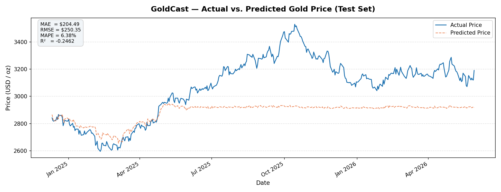
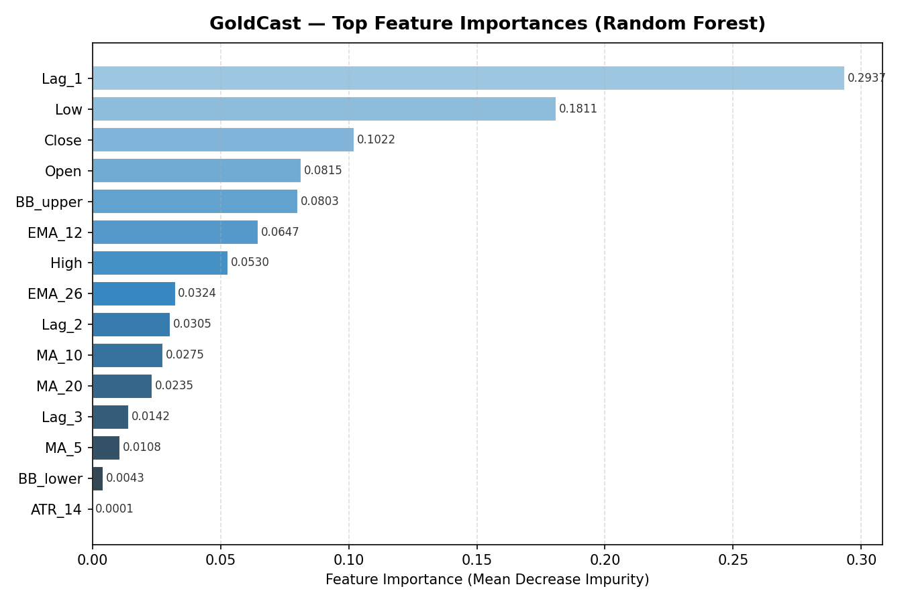
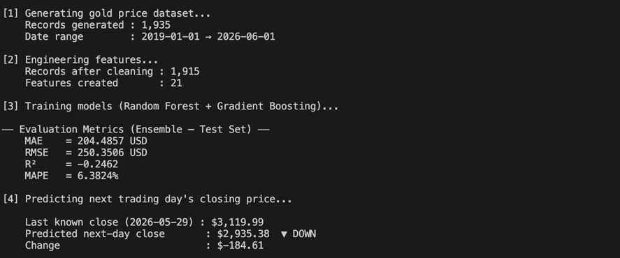

# GoldCast: Gold Price Prediction

Predicts the **next trading day's gold closing price** with two machine learning models,
**Random Forest** and **Gradient Boosting**, then compares how well each one does.



## How it works

1. **Data:** generates realistic daily gold (XAU/USD) prices from Jan 2019 to Jun 2026 using
   *Geometric Brownian Motion*. The starting price, drift, and volatility match gold's real
   historical averages. Simulated data was used because no live market data feed was available.
2. **Feature engineering:** builds 21 technical indicators: moving averages (MA and EMA), MACD,
   RSI, Bollinger Bands, ATR, daily returns, and lagged prices (1–3 days).
3. **Training:** trains a Random Forest and a Gradient Boosting regressor (200 trees each) on
   scaled features, then averages their predictions into an ensemble.
4. **Evaluation:** reports **MAE, RMSE, and R²** on a held-out test set.
5. **Prediction:** forecasts the next trading day's closing price.



## Sample output



The R² on this run is slightly negative. Because the prices are simulated as a random walk,
there's very little real signal to learn, so the ensemble does about as well as predicting the
average. That makes this a useful baseline before trying it on real market data.

## Tech

Python · pandas · NumPy · scikit-learn · matplotlib · seaborn

## Run it

```bash
pip install numpy pandas scikit-learn matplotlib seaborn
python3 gold_price_predictor.py
```

The program prints the evaluation metrics and the next-day prediction, and saves both charts to `goldcast_output/`.

## Author

**Ousmana Tunkara** · [GitHub @Kodelack47](https://github.com/Kodelack47)
